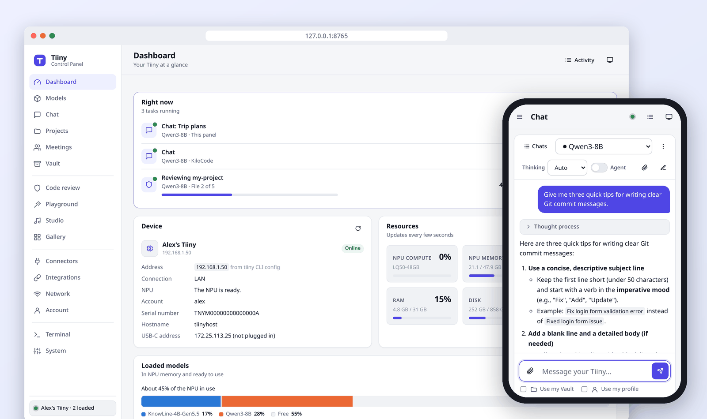
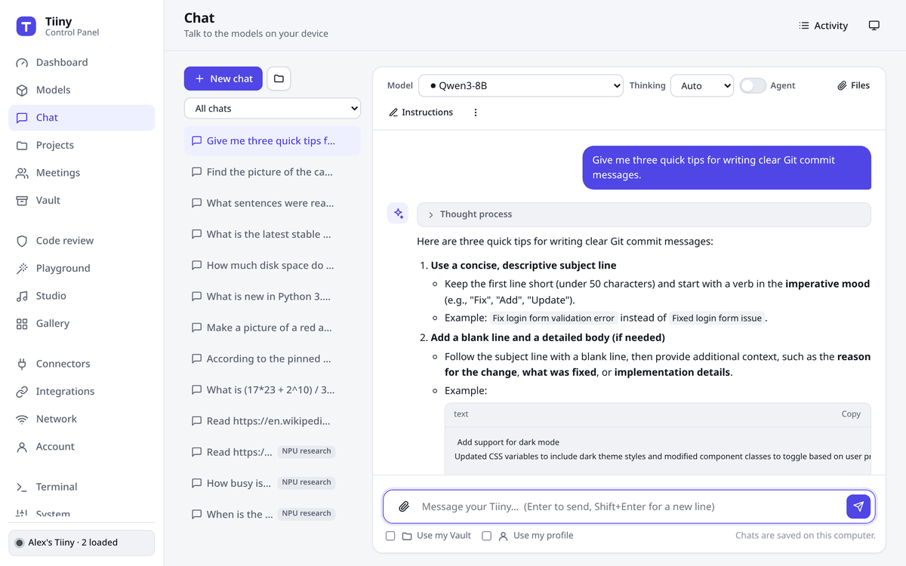
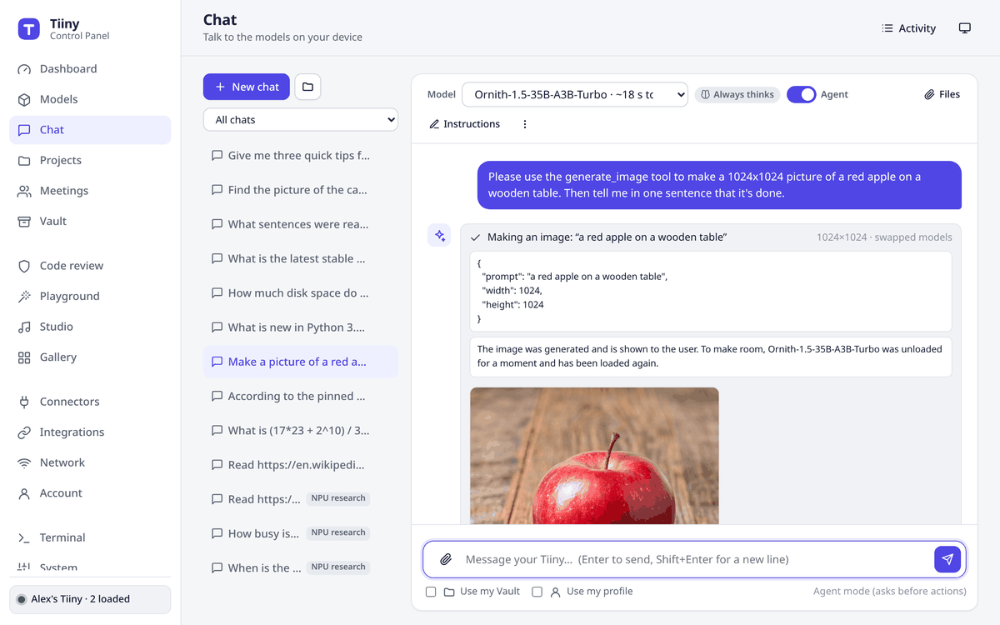
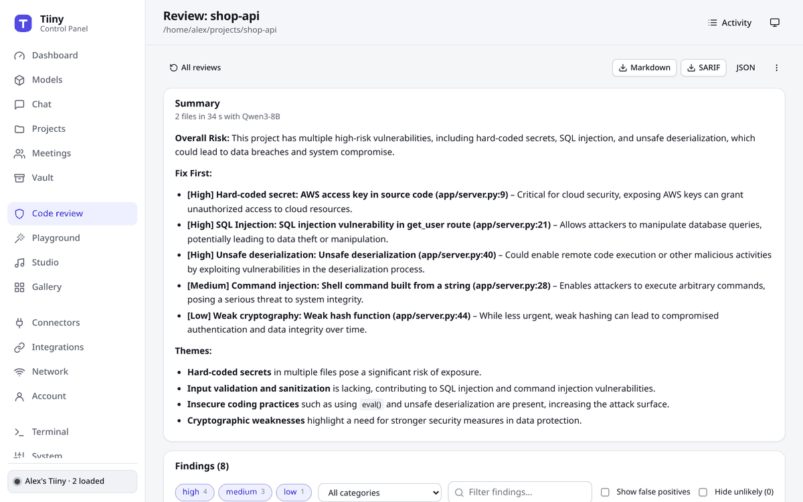
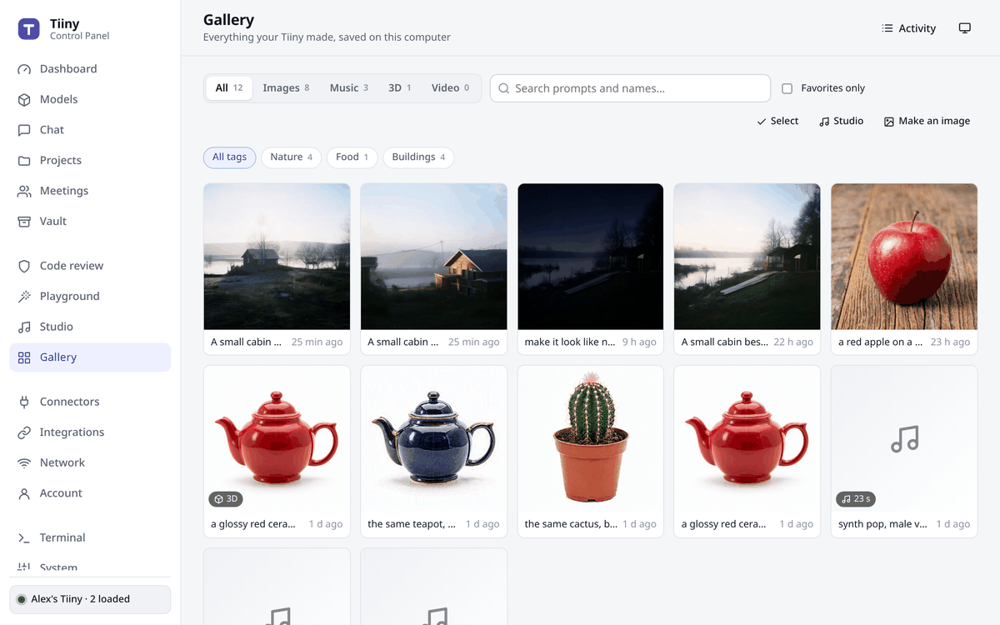

<div align="center">


# Tiiny Control Panel

**A private, friendly web control panel for your Tiiny AI device.**<br>
Chat, agents, projects, a music and 3D studio, meeting notes, code review and more, all on your own hardware.

[](https://github.com/0xStian/tiiny-control-panel/actions/workflows/ci.yml)
[](docs/USER_GUIDE.md#what-you-need)
[](docs/USER_GUIDE.md#debian-ubuntu-fedora-arch-and-other-linux)
[](#quick-start)
[](LICENSE)

[**Quick start**](#quick-start) · [**Features**](#features) · [**Screenshots**](#screenshots) · [**User guide**](docs/USER_GUIDE.md) · [**FAQ**](#faq)



</div>

> [!NOTE]
> **A community project.** This is an independent, open-source panel made for Tiiny owners. It isn't affiliated with or endorsed by Tiiny.

The official `tiiny` command-line tool can do everything, but you have to remember the commands. This panel puts all
of it in your browser, adds what the command line doesn't have, and stays private. It runs on your own computer, it
only talks to your Tiiny, and nothing goes to the cloud.

## Features

| | |
|---|---|
| 💬 **Chat** | Streaming answers with a live thought process, image and document attachments, files pinned to a chat with clickable citations, answers from your Vault. Say your message with 🎤, or have an answer read aloud with 🔊. |
| 🤖 **Agent mode** | The model can search the web, your files and your past chats and meetings, read web pages, check the device, make and edit images and, if you allow it, work on your computer. You choose which tools it may use, and it asks before anything changes. |
| 📁 **Projects** | Workspaces with their own instructions, model, files, web pages, a linked folder and a memory of facts and decisions. |
| 🧠 **Models** | Load, unload, download and benchmark. It measures real NPU memory use, makes room when a model doesn't fit, and unloads idle models. |
| 🎵 **Studio** | Write songs (with a quick preview), turn pictures into textured 3D models, make videos when a video model is installed. |
| 🖼️ **Playground and Gallery** | Create and edit images, text to speech, transcription, OCR. Everything the device makes is kept and easy to reuse. |
| 🎯 **Decision models** | With a decision model like KnowLine or d3 on your Tiiny, the panel gives the agent only the tools a message needs, decides when to think, drops unrelated Vault passages, flags risky commands, double-checks code-review findings, tags Gallery pictures and lists a meeting's action items. |
| 🎙️ **Meetings** | Live transcripts, plus notes written on your device: overview, decisions, action items and open questions. |
| 🛡️ **Code review** | A model on your device checks a folder for security problems and bugs, with suggested fixes. Exports as SARIF. |
| 📚 **Vault** | Upload documents and web pages, then search them by meaning. |
| 🔌 **Integrations** | Ready-to-copy setups for apps that speak the OpenAI, Anthropic or Ollama API: Open WebUI, Continue, Zed, LangChain and more. |
| 📈 **Dashboard** | What the device is working on right now and for whom, live NPU, memory and CPU use, history charts, and how fast each model answers. |
| 📱 **Phone and app** | A phone layout, QR-code pairing, install as an app, desktop notifications. |
| ⚙️ **Device and panel** | Wi-Fi, connectors, account, firmware updates, power, and a real terminal for any `tiiny` command. Backups of the device and of the panel's own data, and updates for the panel itself. |

## Quick start

You need a Tiiny, a Linux computer on the same network (or connected by USB-C), and Python 3.8 or newer.
Nothing else gets installed.

**1. Install the official `tiiny` command-line tool**

```bash
curl -fsSL "https://tiiny-cli.tiiny.cloud/install-linux.sh" | bash && source ~/.profile
```

**2. Connect to your Tiiny and log in**

```bash
tiiny scan                  # finds your Tiiny and shows its address
tiiny connect 192.168.1.50  # use the address from the scan
tiiny login
```

A brand-new device must be activated first, over USB-C, with `tiiny init`. See [setting up a new device](docs/USER_GUIDE.md#3-connect-to-your-tiiny).

**3. Start the panel**

```bash
git clone https://github.com/0xStian/tiiny-control-panel.git
cd tiiny-control-panel
python3 tiiny_ui.py
```

Your browser opens the panel at **http://127.0.0.1:8765**, already signed in. Then:

1. Load a model on **Models**.
2. Press **Chat**.
3. Try switching on **Agent**.

The [user guide](docs/USER_GUIDE.md) walks through every page.

## Screenshots

<table>
  <tr>
    <td width="50%"><a href="docs/USER_GUIDE.md#chat"></a><br><sub><b>Chat</b>: streaming answers, thinking, attachments and citations</sub></td>
    <td width="50%"><a href="docs/USER_GUIDE.md#agent-mode"></a><br><sub><b>Agent mode</b>: the model uses tools, and asks before it changes anything</sub></td>
  </tr>
  <tr>
    <td width="50%"><a href="docs/USER_GUIDE.md#code-review"></a><br><sub><b>Code review</b>: security problems and bugs, with fixes</sub></td>
    <td width="50%"><a href="docs/USER_GUIDE.md#gallery"></a><br><sub><b>Gallery</b>: images, songs and 3D models made on your device, with tags</sub></td>
  </tr>
</table>

More, with every button explained: [the user guide](docs/USER_GUIDE.md).

## Requirements

- **A Tiiny device.** New or already activated.
- **Any common Linux.** Debian, Ubuntu, Mint, Fedora, Arch, openSUSE and others, on x86-64 or 64-bit ARM ([commands for each](docs/USER_GUIDE.md#debian-ubuntu-fedora-arch-and-other-linux)).
- **Python 3.8 or newer.** It uses only the standard library, and is tested with 3.8 to 3.14.
- **The official `tiiny` command-line tool** (step 1 above).
- **A web browser.** Chrome, Edge, Firefox or Safari, on a computer or a phone.

## Privacy and security

- **Nothing leaves your network** unless you ask. It talks to your Tiiny, to web pages you have it read, to a search engine when the agent searches the web (only the search words), and to GitHub when you check for a new version of the panel. No analytics, no fonts or scripts from other sites.
- **Only your browser can use it.** It listens on `127.0.0.1` and only works in a browser it has signed in, so other programs, user accounts and websites can't control your device.
- **Your API key stays put.** It comes from the `tiiny` tool's own config and isn't copied anywhere.
- **Phones need pairing.** Phone access is off until you pair a phone with a QR code. Paired phones can't reach your computer's files, settings or terminals, and you can remove one any time.
- **The agent asks first.** Agent actions that change something or go to the internet need your approval. Running commands on your computer is off unless you start the panel with `--allow-commands`, and then every command still asks.

Read more in [Your data and privacy](docs/USER_GUIDE.md#your-data-and-privacy). To report a security problem, see [SECURITY.md](SECURITY.md).

## FAQ

<details>
<summary><b>Does it work on Windows or macOS?</b></summary>

It works on any common Linux distribution. macOS should work (the code is the same), but hasn't been tested. Windows
isn't supported yet: the panel's terminal needs a Unix system.
</details>

<details>
<summary><b>Everything shows "Your Tiiny is locked" or "502 Bad Gateway"</b></summary>

After every restart or power cut, the Tiiny keeps its data locked until you log in. Press **Log in** on the dashboard
(or run `tiiny login`). The rest starts by itself a minute or two later.
</details>

<details>
<summary><b>The page says "This browser isn't signed in"</b></summary>

Open the panel from your app menu, or run `python3 tiiny_ui.py` again. Either one opens it signed in, even when it's
already running. This happens in a new browser, after clearing browsing data, or at a different address
(`localhost` and `127.0.0.1` sign in separately). See [signing in](docs/USER_GUIDE.md#5-start-the-panel).
</details>

<details>
<summary><b>A model won't load</b></summary>

The NPU's memory is probably full. The panel offers to unload other models to make room. **Models → NPU memory**
shows how much each one takes. Big chat models and image models often don't fit together.
</details>

<details>
<summary><b>How do I update the panel?</b></summary>

Go to **System → Tiiny Control Panel** and press **Check for updates**. When there's a new version, press **Update**,
then **Restart now**. Your chats, projects and settings stay as they are. If you cloned the panel with git, `git pull`
in its folder works too. You can also let it check once a day; it only asks GitHub which version is the latest.
</details>

<details>
<summary><b>Can I use it from my phone?</b></summary>

Yes. Go to **System → Phone and other devices**, switch it on, and scan the QR code with your phone. See
[Use it from your phone](docs/USER_GUIDE.md#use-it-from-your-phone).
</details>

<details>
<summary><b><code>tiiny: command not found</code></b></summary>

Open a new terminal. If you use zsh or fish, add `~/.local/tiiny/bin` to your PATH, as shown in the
[guide](docs/USER_GUIDE.md#2-install-the-tiiny-command-line-tool). The panel finds the tool either way.
</details>

More answers are in [Troubleshooting](docs/USER_GUIDE.md#troubleshooting).

## Documentation

- [**User guide**](docs/USER_GUIDE.md): setup, every page explained with screenshots, phones, troubleshooting
- [**Changelog**](CHANGELOG.md)
- [**Contributing**](CONTRIBUTING.md): how the code is organised and how to help
- [**Security**](SECURITY.md)
- [**Tiiny developer docs**](https://dev.tiiny.ai/): the device's API and the official command-line tool

## Contributing

Bug reports, ideas and pull requests are welcome. Please read [CONTRIBUTING.md](CONTRIBUTING.md) first. The short
version: no dependencies, nothing leaves the user's network, and plain language in the interface.

## License

[MIT](LICENSE). The bundled libraries keep their own licenses (MIT, Apache-2.0, BSD-3-Clause); see
[THIRD_PARTY_NOTICES.md](THIRD_PARTY_NOTICES.md).

## Acknowledgements

Built on the [Tiiny developer documentation](https://dev.tiiny.ai/) and the official `tiiny` command-line tool. It
also uses [xterm.js](https://xtermjs.org/), Google's [model-viewer](https://modelviewer.dev/) and
[qrcode-generator](https://github.com/kazuhikoarase/qrcode-generator).

<sub>"Tiiny" and TiinyOS belong to their respective owner. This project is independent and not affiliated with Tiiny.</sub>
