# User guide

Everything about setting up and using the Tiiny Control Panel, page by page.
For the short version, see the [README](../README.md).

## Contents

- [What you need](#what-you-need)
  - [Debian, Ubuntu, Fedora, Arch and other Linux](#debian-ubuntu-fedora-arch-and-other-linux)
- [Set up, step by step](#set-up-step-by-step)
- [Your first five minutes](#your-first-five-minutes)
- [The dashboard](#the-dashboard)
- [The pages, one by one](#the-pages-one-by-one)
  - [Models](#models) · [Chat](#chat) · [Agent mode](#agent-mode) · [Projects](#projects) · [Vault](#vault) · [Meetings](#meetings)
  - [Code review](#code-review) · [Playground](#playground) · [Studio](#studio) · [Gallery](#gallery)
  - [Connectors](#connectors) · [Integrations](#integrations) · [Network](#network) · [Account](#account) · [Terminal](#terminal) · [System](#system)
- [Decision models](#decision-models)
- [Use it from your phone](#use-it-from-your-phone)
- [Install it as an app, or start it automatically](#install-it-as-an-app-or-start-it-automatically)
- [Your data and privacy](#your-data-and-privacy)
- [Good to know about the device](#good-to-know-about-the-device)
- [Troubleshooting](#troubleshooting)
- [How it works](#how-it-works)

---

## What you need

| | |
|---|---|
| **A Tiiny device** | New or already activated. |
| **A Linux computer** | Any common distribution: Debian, Ubuntu, Mint, Fedora, Arch, openSUSE…, on a normal PC (x86-64) or 64-bit ARM. It must be on the **same network** as the Tiiny, or connected to it with a **USB-C** cable. |
| **Python 3.8 or newer** | Almost every Linux system has it. Check with `python3 --version`. Nothing else needs installing: the panel uses only Python's standard library. Tested with Python 3.8 to 3.14. |
| **The `tiiny` command-line tool** | The official one. Step 2 below installs it. |
| **A web browser** | Chrome, Edge, Firefox or Safari. Also on your phone, if you want. |

The panel is these files and folders. Keep them together:

```
tiiny_ui.py      the program you start
tiinyui/         the server side
static/          the pages your browser shows
docs/            only the pictures for this README (not needed to run it)
```

### Debian, Ubuntu, Fedora, Arch and other Linux

The panel is plain Python, so it runs the same on every distribution. Only a few commands differ:

| | Debian, Ubuntu, Mint | Fedora | Arch, Manjaro |
|---|---|---|---|
| Install Python and curl, if missing | `sudo apt install python3 curl` | `sudo dnf install python3 curl` | `sudo pacman -S python curl` |
| Python version you get | Debian 11: 3.9 · Debian 12: 3.11 · Ubuntu 20.04: 3.8 · 22.04: 3.10 · 24.04: 3.12 | 3.12 or newer | the latest |
| Let your phone through the firewall ([why](#use-it-from-your-phone)) | `sudo ufw allow 8765/tcp` (only if ufw is on) | `sudo firewall-cmd --add-port=8765/tcp` | nothing on plain Arch; with ufw (Manjaro, or if you added it): `sudo ufw allow 8765/tcp` |
| Faster PDF reading (optional) | `sudo apt install poppler-utils` | `sudo dnf install poppler-utils` | `sudo pacman -S poppler` |

Good to know:

- **Your shell.** The `tiiny` installer adds itself to `~/.profile` and `~/.bashrc`. If you use **zsh** or **fish** (common on Arch), see step 2 below.
- **Alpine and other musl-based systems.** The `tiiny` command-line tool is built for glibc, so it needs `gcompat`. The panel itself runs anywhere.
- **Systems without systemd** (Alpine, Void, Devuan…). Use your desktop's autostart, or **System → Add to the app menu**, instead of the systemd service [below](#install-it-as-an-app-or-start-it-automatically).
- **Tested on:** Fedora, with Python 3.8, 3.9, 3.10, 3.11, 3.12 and 3.14. Debian and Arch use the same code paths, but haven't been tried on a real machine.

---

## Set up, step by step

### 1. Put the panel on your computer

Download it with git (or use **Code → Download ZIP** on GitHub and unpack it):

```bash
git clone https://github.com/0xStian/tiiny-control-panel.git
cd tiiny-control-panel
```

### 2. Install the `tiiny` command-line tool

```bash
curl -fsSL "https://tiiny-cli.tiiny.cloud/install-linux.sh" | bash && source ~/.profile
```

Check that it worked. This should list commands like `login`, `ls`, `load` and `status`:

```bash
tiiny --help
```

**`tiiny: command not found`?** The installer only adds `tiiny` to `~/.profile` and `~/.bashrc`, so open a new terminal first. On **zsh**, add
`export PATH="$HOME/.local/tiiny/bin:$PATH"` to `~/.zshrc`. On **fish**, run `fish_add_path ~/.local/tiiny/bin`.
The panel finds `tiiny` in `~/.local/tiiny/bin` either way.

### 3. Connect to your Tiiny

**A brand-new device** must be activated first, and activation only works over **USB-C**:

1. Plug the Tiiny into your computer with the USB-C cable and switch it on.
2. Find it with `tiiny scan`. Copy its address from the **IP Address** column.
3. Select it with `tiiny connect <the address>`.
4. Activate it with `tiiny init`. You choose a username and a password, and how you'd recover a forgotten password:
   - **by email** (needs Wi-Fi), or
   - **local only**. Then a forgotten password can't be recovered, so write it down.

**An already activated device** can also be found over your network:

```bash
tiiny scan                  # lists the Tiiny devices it can see
tiiny connect 192.168.1.50  # use your device's address from the list
```

### 4. Log in

```bash
tiiny login
```

Enter the username and password you chose when you activated the device. You get 3 attempts before the device
locks you out. The command-line tool saves an API key in `~/.local/tiiny/config.json`. The panel reads it from there,
so you never type it into the panel.

> You can also do steps 3 and 4 inside the panel: **Network → Scan for devices**, then **Account → Log in**
> (or **Activate a new device**). They run the same commands in a terminal inside the page.

### 5. Start the panel

```bash
python3 tiiny_ui.py
```

Your browser opens the panel at **http://127.0.0.1:8765**, already signed in. The terminal shows something like:

```
Tiiny Control Panel 1.0.0
  tiiny CLI : /home/alex/.local/tiiny/bin/tiiny  (tiiny-cli-linux-amd64-v0.0.5)
  device    : 192.168.1.50  (from tiiny CLI config)
  API key   : found in tiiny CLI config
  your data : /home/alex/.local/share/tiiny-ui
  open      : http://127.0.0.1:8765/  (your browser opens it, signed in)
Press Ctrl+C to stop.
```

Leave that terminal open while you use the panel. **Ctrl+C** stops it. If you start it a second time, it just opens
the one that's already running.

**Signing in.** Other programs and user accounts on your computer can reach `127.0.0.1` too, so the panel only works in
a browser it has signed in. You don't need to do anything: every time you start the panel (from a terminal or your
app menu), it opens your browser with a one-time sign-in link. The browser stays signed in after that, even when the
panel restarts, so bookmarks keep working. If a page ever says *This browser isn't signed in*, start the panel again.

**Options**

| Option | What it does |
|---|---|
| `--port 9000` | Use another port (default 8765, or the `TIINY_UI_PORT` environment variable). |
| `--no-browser` | Don't open a browser window. The terminal shows a one-time sign-in link instead. |
| `--tiiny /path/to/tiiny` | Use a `tiiny` program that isn't in the usual places (or set `TIINY_BIN`). For safety, this can only be set here, not in the page. |
| `--cli-config FILE` | Use another config file for the `tiiny` tool (default `~/.local/tiiny/config.json`). |
| `--allow-commands` | Let agent mode run commands and read and write files on this computer. It asks before every command and file change (see [Agent mode](#agent-mode)). |
| `--verbose` | Log every request in the terminal. |
| `--tls-cert cert.pem --tls-key key.pem` | Serve the phone listener over HTTPS with your own certificate (see [phones](#use-it-from-your-phone)). |
| `--host` | Listen on another address. Don't: anyone who can reach it could control your device. Use the phone pairing instead. |

---

## Your first five minutes

1. **Load a model.** Open **Models** and press **Load** on a chat model (types *Text Generation* or *Image-Text-to-Text*). `Qwen3-8B` is a good, fast first choice.
2. **Chat with it.** Press **Chat** on that model, type a message and press Enter.
3. **Give it your documents.** Drop a PDF onto the **Vault** page. Then tick **Use my Vault** under the chat box, and the model answers from your files.
4. **Try the agent.** Switch on **Agent** in a chat and ask *"How busy is my Tiiny right now?"*. It checks the device itself.
5. **Make something.** Open **Playground** to create an image, or **Studio** to write a song.

Models have to be **loaded into the NPU's memory** (the device's AI chip) before you can use them, and that memory is
shared. Most of the time the panel takes care of it: it loads a model when you need it and asks before unloading
another one to make room.

---

## The dashboard

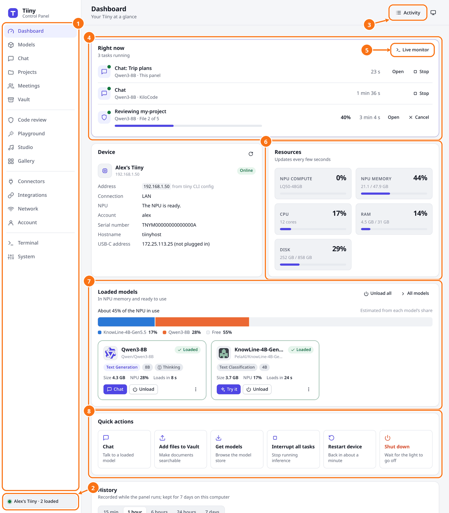

1. **Pages.** Every part of the panel. On a phone this list is behind the ☰ button.
2. **Device status.** Green means your Tiiny is online. It turns into a warning like *Locked · log in to unlock*, *Device offline* or *Log in required* when something needs you. Click it to come back to the dashboard.
3. **Activity.** A log of every request and `tiiny` command the page ran, with the output. Useful when something fails.
4. **Right now.** What your Tiiny is working on, one line per task: the kind of work (a chat, an image, a decision, …),
   the model, who asked for it and how long it has been running. When nothing runs it says *Idle*, with what ran last.
   - **This panel's work is named.** You see *Chat: Trip plans*, *Reviewing my-project* or *Making an image ·
     Playground*, with **Open** to go to that chat or page. Background jobs (code reviews, Studio renders, meeting
     notes, project indexing, Gallery tags) show their progress.
   - **Other programs** show by name when the device knows them (for example *KiloCode* from the Agent Store). Anything
     else that uses the device's API shows as *Another app or computer*.
   - Models loading or downloading show here too, with their progress.
   - **Stop** stops everything running on that model (it asks first and lists what will stop); the model stays loaded.
     **Cancel** stops one of the panel's background jobs. After a Cancel, the device may still finish the request it
     was in the middle of; the line then says so, and **Stop** ends it right away.
5. **Live monitor.** Opens `tiiny top` in a terminal window.
6. **Resources.** Live NPU, CPU, memory and disk use of the device. The NPU numbers come from the NPU card your
   models run on (LQ50-48GB). It only reports while a model is loaded, so with nothing loaded it shows as idle.
7. **Loaded models.** Which models are in the NPU's memory, how much each one takes, and buttons to chat with or unload them.
8. **Quick actions.** Shortcuts: chat, add files, get models, stop all tasks, restart or shut down the device.

Further down the dashboard you'll find **History** (charts of the last 15 minutes to 7 days) and **Speed** (how fast each model answers your chats).

---

## The pages, one by one

### Models

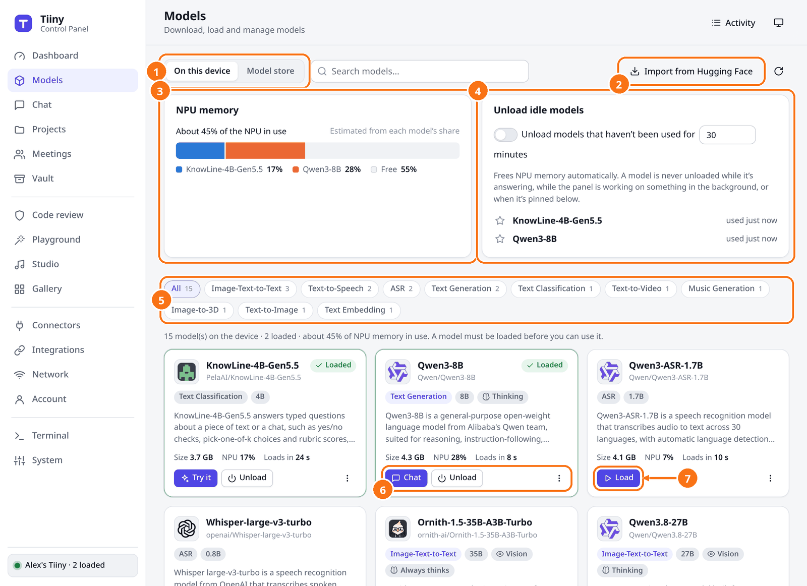

1. **On this device / Model store.** Your downloaded models, or the store to download new ones (the device needs internet access over Wi-Fi or Ethernet).
   Store models show how many times they've been downloaded (⤓) and liked (♥); sort by **Most downloaded** to see the
   popular ones. The panel remembers the order you pick.
2. **Import from Hugging Face.** Bring in a compatible model that isn't in the store.
3. **NPU memory.** How full the NPU's memory is and which model takes how much. Two big models often don't fit together.
4. **Unload idle models.** Switch this on and the panel unloads models nobody used for a while. Click the ☆ next to a model to keep it loaded anyway.
   Models that 🎤 or 🔊 or an app loaded just for themselves are unloaded again even with this off (see [Chat](#chat) and [Integrations](#integrations)).
5. **Filters** by type: chat models, speech recognition (ASR), image, music, 3D, [decision models](#decision-models)
   (*Text Classification*) and more.
6. **A loaded model**: **Chat** opens a chat with it, **Unload** frees its memory. The **⋮** menu has *Details*, *Interrupt current task*, *Benchmark speed*, *Copy model ID* and *Delete from device*.
   A decision model has **Try it** instead of Chat: it opens the Playground's Decide tab.
7. **Load** puts a model into NPU memory. Each card shows its size, its share of NPU memory and how long it takes to load.

If a model doesn't fit next to the loaded ones, a **Make room** dialog suggests which ones to unload (least recently
used first) and shows how full the NPU will be afterwards.

### Chat

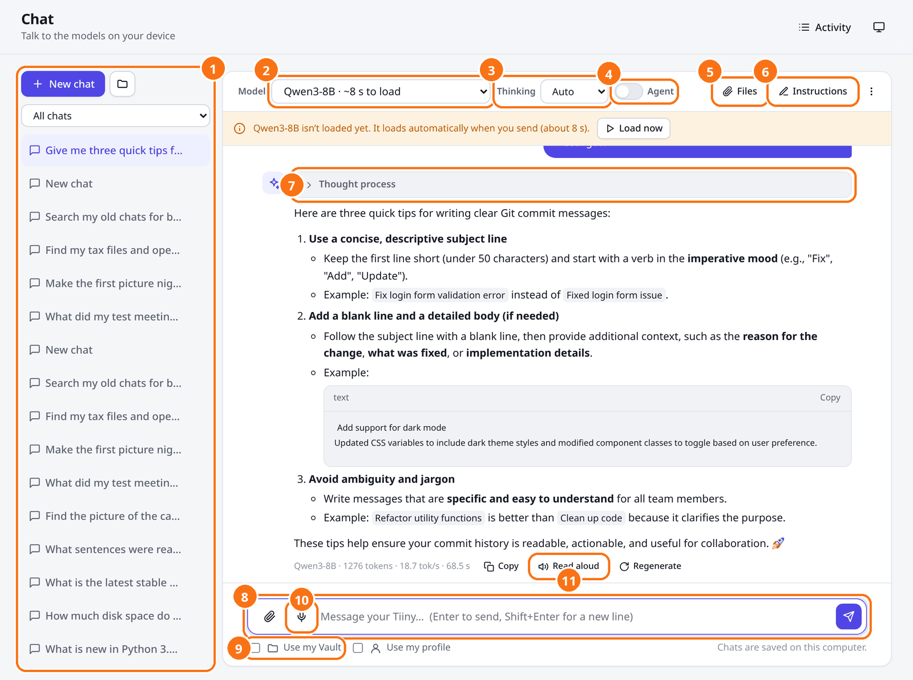

1. **Your chats.** **New chat** starts one; the folder button opens Projects. The list can show all chats or one project's.
2. **Model.** Which model answers. *Auto* lets the device pick a loaded one. The model loads by itself when you send.
3. **Thinking.** For models that can reason before answering. Some models always think; then you see a badge instead.
   With a [decision model](#decision-models) on your Tiiny, **Auto** decides for each message whether to think and how much.
4. **Agent.** Lets the model use tools. See [Agent mode](#agent-mode).
5. **Files.** Pin documents to this chat: uploads, Vault files or web pages. Answers then quote them with clickable sources like **[1]**.
6. **Instructions.** Standing instructions for this chat, for example *"answer in British English"* or *"you are a patient maths tutor"*.
7. **Thought process.** The model's reasoning. It's open and follows the newest thoughts while the model thinks, and folds away when the answer starts. Scroll it, or open and close it, as you like.
8. **Message box.** **Enter** sends, **Shift+Enter** starts a new line. The 📎 button attaches images (for vision models), text files and documents. You can also paste or drop them.
9. **Use my Vault** looks up passages in your Vault for every message, and a [decision model](#decision-models) leaves out
   the ones that don't fit the question. **Use my profile** tells the model about you (from *Account → Personalization profile*).
10. **🎤 Say your message.**
    - **Recording:** press it and talk. Press it again (or Enter) when you're done; it stops by itself after 2 minutes, and
      **Esc** throws the recording away.
    - **Writing it down:** a speech recognition model on your Tiiny (for example Whisper) writes down what you said in
      the message box, so you can check it before you send.
    - **A secure page:** the microphone only works on one. On this computer it always is; on a phone you need
      [HTTPS](#use-it-from-your-phone).
11. **🔊 Read aloud.** A voice model on your Tiiny (for example Qwen3-TTS) speaks the answer, leaving out code, Markdown and
    citations. It starts after a few seconds and makes the next part while it speaks. **Stop** ends it.

**When you're done with 🎤 or 🔊**, a model it had to load is unloaded again, 2 minutes after its last use, even if
you close the page:
- **Models that stay loaded:** one that was already loaded before, and one you start using somewhere else in the
  meantime (Meetings, the Playground).
- **Keeping it yourself:** **Keep loaded** on the model's card (Dashboard, Models).
- **Changing it:** **⋮ → Voice…** sets the wait (straight away, 2 or 10 minutes) or keeps the models loaded.

The **⋮** menu (top right of the chat) can:
- rename the chat, move it to a project, or copy it as Markdown;
- set up the **Voice**: which models write down what you say and read answers aloud, the language you speak, how the
  voice sounds, and when the models they had to load are unloaded again;
- clear the chat or delete it.

Under each answer: **Copy**, **Read aloud**, **Regenerate**, and how many tokens it took and how fast.

### Agent mode

With **Agent** switched on, the model can use tools on your behalf:

| Reads (runs straight away) | Goes to the internet or changes something (asks first) |
|---|---|
| Search the Vault, search and read a project's files | Search the web, read a web page |
| Search and open your past chats, meetings and Gallery | Save a note or a web page to the Vault |
| Check the device (memory, loaded models), list the models | Load or unload a model |
| Calculator, current date and time | Make an image, edit an image |

**Fewer tools, better picks.** With a [decision model](#decision-models) on your Tiiny, the agent first works out which
kinds of tools a message could need (web, your files and history, the device, images, this computer) and only gets
those, so smaller models choose better. The message says which ones it got. Commands it wants to run also get a
plain risk note on the approval card ("thinks it deletes or overwrites files"); you're still asked every time.

**Your history.** Ask about something from before ("what did we decide in Monday's meeting?", "find the teapot
picture") and the agent searches your saved chats, meeting notes and transcripts, and the Gallery, then opens the
right one. Each result links to it.

**Editing images.** "Make it night time" changes the last image in the chat, a picture you attached, or one the agent
found in your Gallery. The approval card shows which picture. The result keeps the picture's shape, goes into the
Gallery next to the original, and needs an image model that can edit (Qwen-Image, FLUX, HiDream or SenseNova).
Add-ons made for one job, like FLUX.2-klein Background-Remove, aren't used for this; Studio → 3D uses that one for its
cut-outs.

**Searching the web.** The agent searches first and then reads the most useful results, so it works with real
addresses instead of guessing them. Each search step lists the links it found; click one to open it. Searches go to
DuckDuckGo by default, with no account needed. Under **System → Agent tools** you can switch to
[Brave Search](https://api-dashboard.search.brave.com/) (needs an API key) or your own
[SearXNG](https://docs.searxng.org/) server, which can include Google's results. Only the search words go to the
search engine. (Google's own search API is closed to new users and shuts down in January 2027, so it isn't offered
directly.)

**Working on your computer (off unless you turn it on).** Start the panel with `--allow-commands` and the agent can
also run commands, find files, open them, and read and write them on this computer:

```bash
python3 tiiny_ui.py --allow-commands
```

- **It asks before every command, every file change and everything it opens**, showing the exact command (with its
  folder and time limit), the file and its new text, or what it will open. There's no *Always* button for these, and
  *never ask in this chat* doesn't skip them. Finding and reading files ask like reading a web page does.
- **Finding files** looks in your home folder (or a folder the agent picks), by name or by text inside the files, and
  skips hidden folders. **Opening** shows a file or folder in its usual app, or a link in your browser. It never runs
  programs or scripts.
- Commands run as you, in your home folder unless the agent picks another one, with no terminal and no input. They
  stop after a time limit (2 minutes unless the agent sets another, at most 15), and **Stop** ends them.
- **sudo can't work**: there's nowhere to type a password. The agent tells you to run admin commands yourself.
- Risky-looking commands (deleting many files, running a script from the internet, stopping programs) come with a
  warning on the approval card. Read what you approve: the agent can make mistakes.
- Phones never get these tools, even when they're on.

**Choosing which tools it may use.** **System → Agent tools** (or *Agent tools…* in a chat's **⋮** menu). A tool
that's off is never offered to the model, in any chat, so it can't use it. Turning *Past chats, meetings, Gallery*
off keeps the agent out of your history, for example. Phones can't change these.

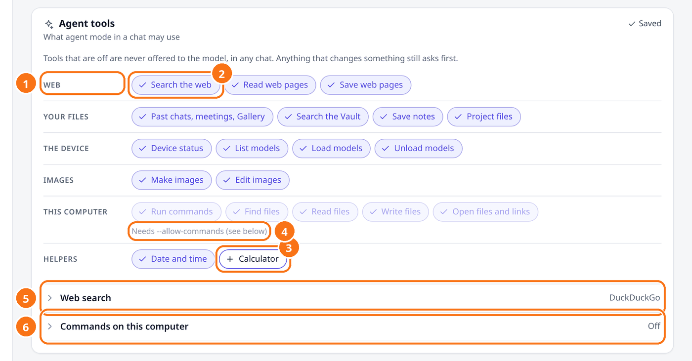

1. One row per kind of tool: the web, your files, the device, images, this computer and small helpers.
2. **✓** The agent may use this tool. Click the pill to switch it off; it's saved straight away (*✓ Saved* shows at
   the top right).
3. **+** This tool is off. Click to switch it back on.
4. The computer tools are greyed out until you start the panel with `--allow-commands`. The switches can only take
   tools away, never add these.
5. **Web search**: which search engine the agent uses (DuckDuckGo, Brave Search or SearXNG), with a test search.
6. **Commands on this computer**: whether the agent may work on this computer, and how to allow it.

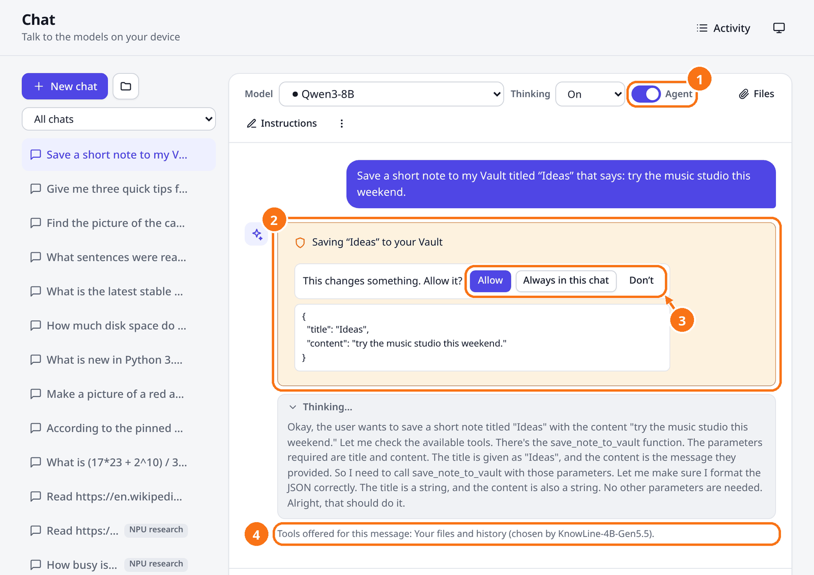

1. The **Agent** switch.
2. What the agent wants to do, with the exact details it will send.
3. **Allow** (this once), **Always in this chat**, or **Don't**. If you say no, the agent carries on without it.
4. The kinds of tools a [decision model](#decision-models) offered the agent for this message: here *Your files and
   history*, because the message is about the Vault.

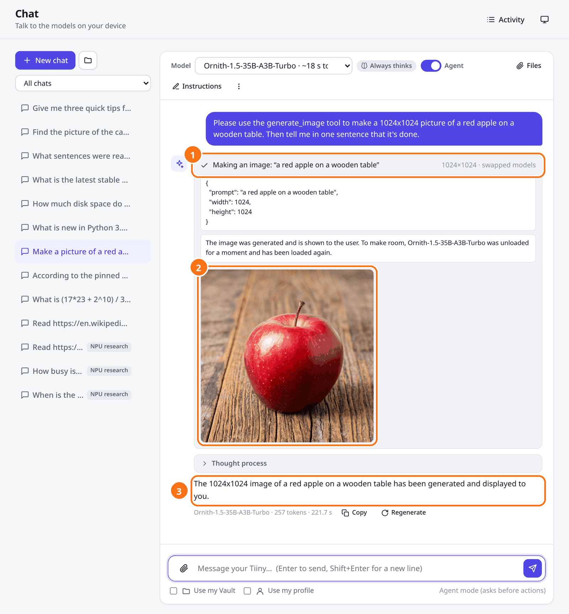

1. Each step shows what was done. *Swapped models* means the image model needed the memory of the chat model, so the panel unloaded the chat model for a moment and loaded it again afterwards.
2. The image. It's saved in the [Gallery](#gallery) too.
3. The agent's answer.

Good to know:

- The agent **never unloads the model it's running on**, because that would end the chat.
- **Image models are large.** When one doesn't fit next to your chat model, the panel tells you on the approval card and swaps them for the moment. That adds a minute or two. Small chat models like `Qwen3-8B` fit next to an image model and need no swap.
- The **⋮** menu has *Agent: never ask in this chat* if you trust it with everything in one chat, and *Agent: ask before actions* to undo that. Commands and file changes on your computer still ask every time.
- Text from web pages and search results is marked as untrusted for the model, so instructions hidden in a page aren't followed.

### Projects

A project is a workspace: every chat in it gets the project's **instructions**, **model**, **files** and **memory**.

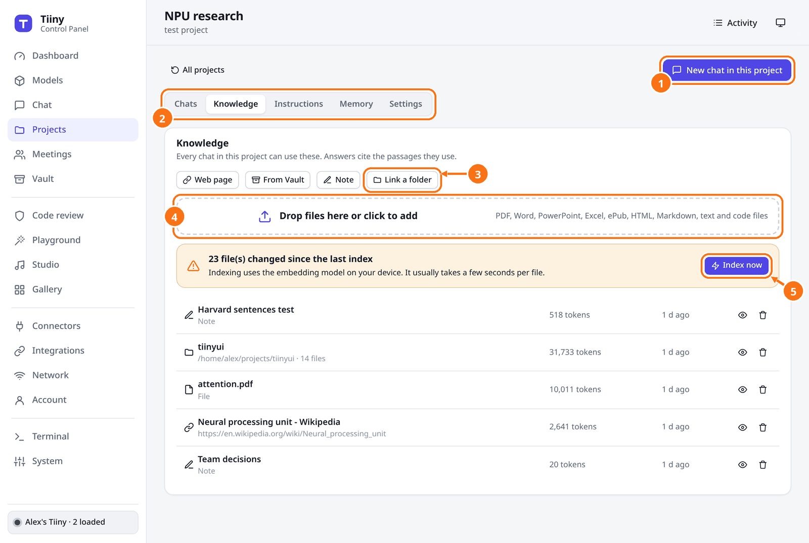

1. **New chat in this project.**
2. **Tabs**:
   - **Chats** in the project.
   - **Knowledge**, the project's files.
   - **Instructions** for every chat in the project.
   - **Memory**: facts and decisions the panel picks up from your chats. You can edit or delete them, or switch memory off.
     With a [decision model](#decision-models), turns with nothing worth remembering are skipped without running the chat model.
   - **Settings**, including the project's model and agent mode.
3. **Add knowledge.** A web page, a Vault file, a note you type, or **Link a folder** on this computer. Linked folders are re-read when their files change.
4. **Drop files** here: PDF, Word, PowerPoint, Excel, ePub, HTML, Markdown, text and code.
5. **Index now.** Files are made searchable with an embedding model on your device (for example `Qwen3-Embedding-0.6B`). The panel loads one when needed.

Answers in project chats cite the files they used.

### Vault

The Vault is the device's own document store. Files here can be searched by meaning, used in chats with **Use my Vault**, and
used by the device's own features.

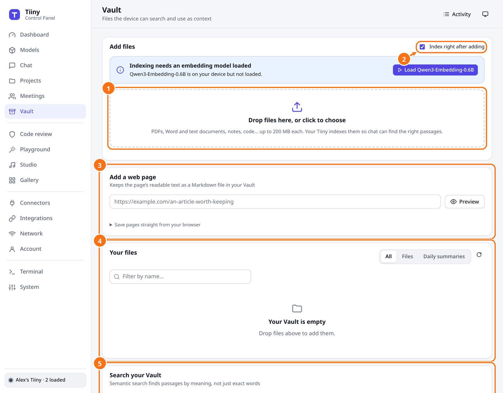

1. **Drop files** (or click) to upload. Up to 200 MB each.
2. **Index right after adding.** Makes new files searchable straight away. This needs an embedding model loaded; the banner above offers to load one.
3. **Add a web page.** Paste an address, check the preview, and the page's readable text is saved as a Markdown file. Under *Save pages straight from your browser* there's a **Save to Tiiny** button to drag to your bookmarks bar.
4. **Your files**, with filters, rename, re-index and delete. *Daily summaries* are the device's own nightly summaries of your conversations.
5. **Search your Vault.** Ask in plain words; it finds passages by meaning, not just exact words.

### Meetings

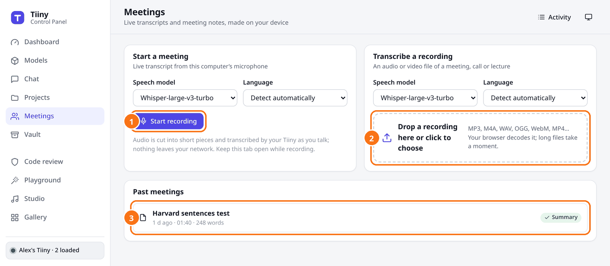

1. **Start recording.** Live transcript from this computer's microphone. Audio is cut into short pieces and transcribed by your Tiiny as you talk. Keep the tab open while recording.
2. **Transcribe a recording.** Drop an audio or video file (MP3, M4A, WAV, OGG, WebM, MP4…).
3. **Past meetings.**

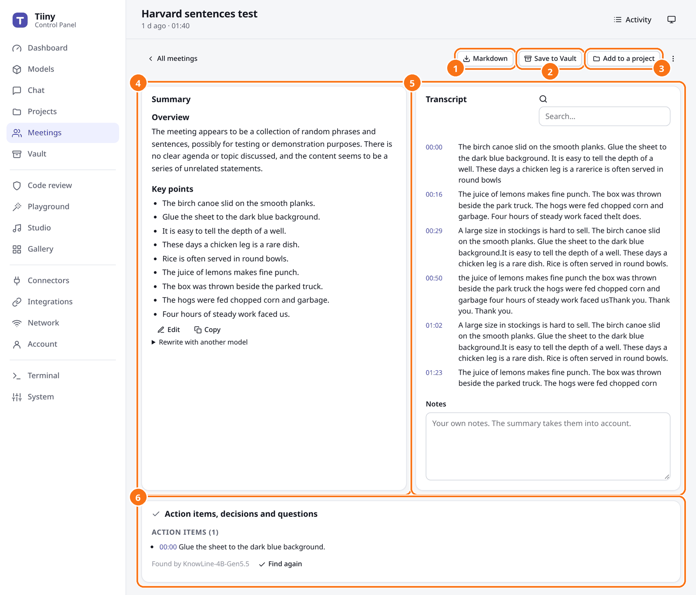

When a recording ends, a chat model on your device writes the notes: overview, key points, decisions, action items
(with owner and date when they're mentioned) and open questions.

1. **Markdown.** Download the notes and transcript.
2. **Save to Vault.**
3. **Add to a project.**
4. **Summary.** Edit it, copy it, or rewrite it with another model.
5. **Transcript**, with timestamps and search. Your own **Notes** below it are taken into account by the summary.
6. **Action items, decisions and questions.** With a [decision model](#decision-models), the transcript is gone
   through sentence by sentence after the summary (or with **Find them**). Click a time to jump to that line. A
   sentence said more than once is listed once, at the first time.

### Code review

Have a model on your device check code for security problems and bugs. Your code never leaves your network.

1. On **Code review**, pick **a folder on this computer**, **a ZIP file**, or **a project's linked folder**, and press **Scan**.
2. Choose which files to review (*Code only* is a good start), the model (bigger ones catch more) and what to look for: *Security*, *Bugs* or *Both*.
3. Press **Start review**. You can leave the page; the review keeps running. If your Tiiny stops answering, the review pauses and you can **Resume** it later.

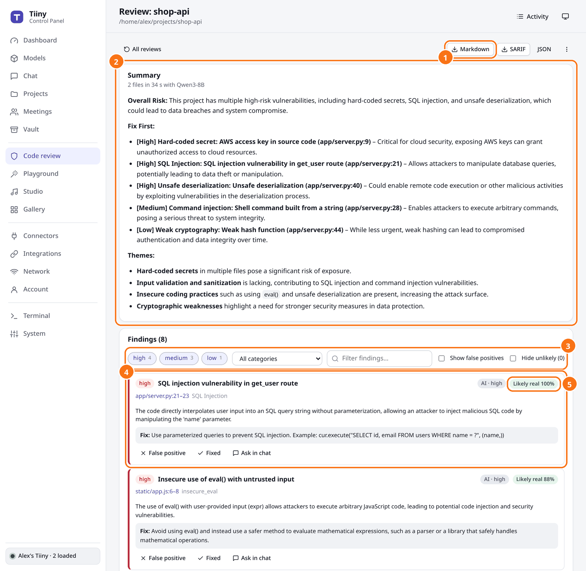

1. **Export** as Markdown, SARIF (for code-scanning tools) or JSON.
2. **Summary**: overall risk, what to fix first, recurring themes.
3. **Filters** by severity and category, a search box, *Show false positives*, and *Hide unlikely* (findings a
   decision model puts under 30%).
4. **A finding**: the problem, where it is (click to see the code), and a suggested **Fix**. Mark it as **False positive** or **Fixed**, or **Ask in chat** for an explanation.
5. **Likely real.** With a [decision model](#decision-models), each finding the review model made is checked again
   against its file: how likely it's a real problem. Within each severity, the likeliest come first.

A pattern scan for hard-coded secrets and risky calls (like `eval` or shell commands) runs as well, so some findings are
marked *pattern*. Treat the results as a careful first pass, not a guarantee.

### Playground

Try the device's other model types one at a time.

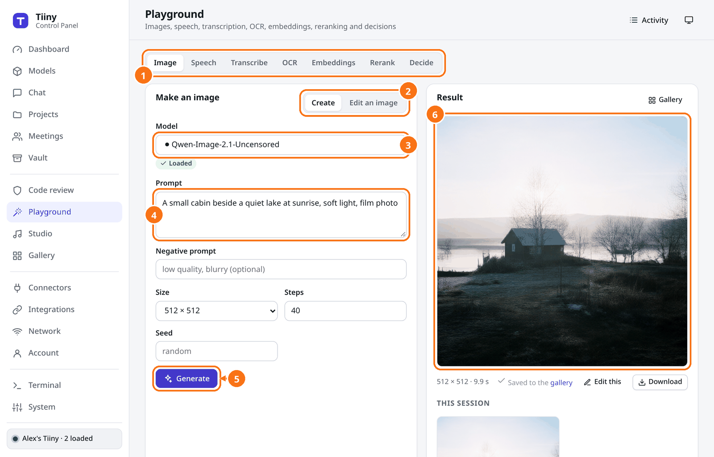

1. **Tabs**:
   - **Image**: create or edit.
   - **Speech**: text to speech.
   - **Transcribe**: speech to text.
   - **OCR**: text in images.
   - **Embeddings** and **Rerank**: building blocks for search.
   - **Decide**: ask a [decision model](#decision-models) yes/no, pick-one and score questions about a text or a
     picture, and see the probability of every answer. Start from an example.
2. **Create**, or **Edit an image**: upload up to 10 reference images (or pick them from the Gallery) and describe the change.
3. **Model.** It loads automatically when you press Generate.
4. **Prompt**, describing what you want. Below it: what to avoid, size, steps (more steps take longer but look better) and a seed (the same seed gives the same picture again).
5. **Generate.**
6. **Result.** It's saved in the Gallery. *Edit this* sends it back to the editor.

**Speech** has three ways of speaking, and picks the one that suits the model you choose:

- **Describe a voice** (Qwen3-TTS *VoiceDesign* models): write who is speaking and how, like "a deep, slow male
  voice", or click one of the examples.
- **Copy a voice** (Qwen3-TTS *Base* models, shown as *VoiceClone*): give a clear 5–15 second recording of one person,
  from a file or the microphone, and exactly what it says. *Write it out for me* fills that in with a speech
  recognition model such as Whisper; check that the words match. Only copy voices you have permission to use.
- **Built-in voice** (Qwen3-TTS *CustomVoice* and other models): leave the voice empty for the model's default, or
  type a voice name if the model needs one.

If a model says it can't speak that way, the card tells you which way to choose instead.

Image edits get about 2½ minutes on the device. Around 20 steps, or a smaller size, keeps them within that.

### Studio

Longer creative work. It runs on the panel's server, so you can close the tab and come back.

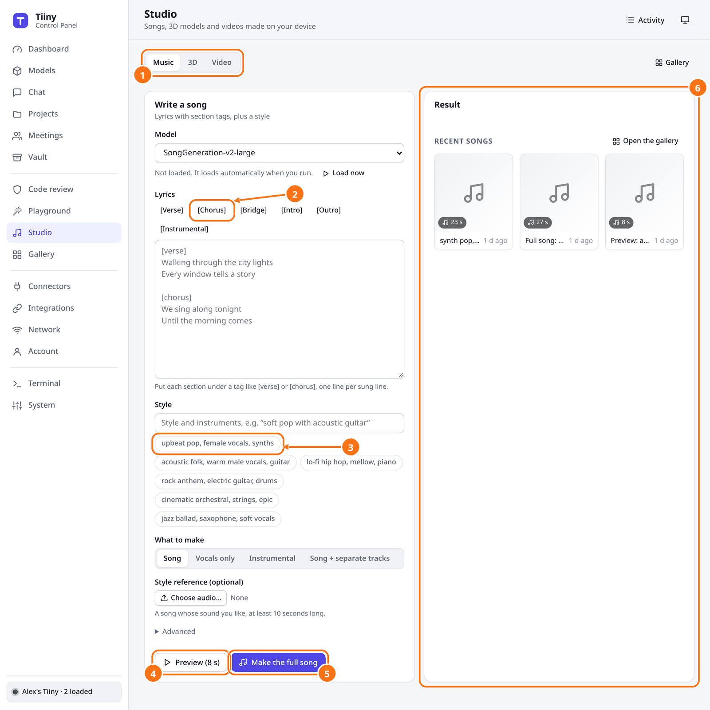

1. **Music**, **3D** or **Video**.
2. **Lyrics.** These buttons insert section tags like `[verse]` and `[chorus]`. One line per sung line.
3. **Style.** Describe the sound, or start from one of these ideas. Then choose what to make: a song, vocals only, instrumental, or a song plus separate tracks. You can add a style reference song (at least 10 seconds).
4. **Preview (8 s).** A quick taste. If you like it, *Continue to the full song*.
5. **Make the full song.** You get a WAV, and an MP3 when the device makes one.
6. **Result** and your recent songs.

**3D** turns a picture into a textured 3D model (a GLB file) in five steps on the device. It takes about 8 minutes at
*Fast*, and you can pause or cancel. You can turn the result around in the page.

**The background.** With **Background: Cut it out (AI)**, the object is cut out of your picture before the 3D steps, so
the background doesn't end up in the model:
- **The model that does it:** FLUX.2-klein Background-Remove, an image model that runs on your Tiiny (7.2 GB from the
  model store; **Get it** on the 3D page opens the store at it). It works on busy backgrounds too, like a table or a room.
- **The preview:** when you choose a picture, the cut-out appears next to it after about half a minute, on a
  checkerboard so you can see what's left out. **Try again** makes a new one.
- **Memory:** if the model wasn't loaded, the panel loads it just for the cut-out and unloads it afterwards (it loads in
  seconds), so the 3D model has the NPU to itself.
- **Keep it** sends your picture as it is, background and all. So does **Cut it out** when the model isn't on your
  Tiiny yet; the 3D page says so.

**Video** appears when a video model is on your device.

### Gallery

Everything your Tiiny made (images, songs, 3D models, videos) is kept on your computer here.

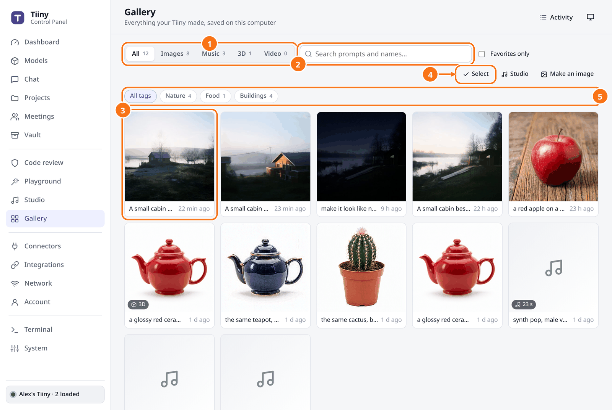

1. **Filter** by type.
2. **Search** prompts and names. You can also show only favourites.
3. **Click an item** to open it.
4. **Select** several items to delete them, or add them to your favourites, all at once.
5. **Tags.** With a [decision model](#decision-models), pictures get tags when they're saved: people, animals,
   nature, food, buildings, vehicles, text or art. Click a tag to show only those pictures (then **Select all** to act
   on them). **Tag N pictures** appears here when older pictures have no tags yet.

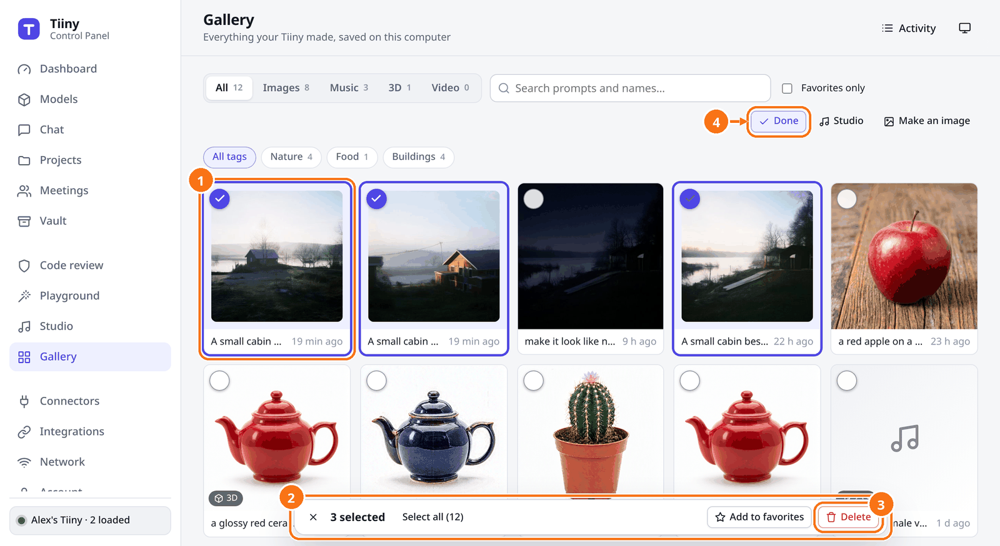

1. **Marked items** have a blue frame and a tick. Click an item to mark it or unmark it.
2. **The bar** shows how many are marked, with **Select all**, **Add to favorites** and **Delete**.
3. **Delete** shows what will be deleted and asks first. The files are removed from your computer.
4. **Done** stops selecting (Esc too).

More about selecting:
- **Starting:** click **Select**, or point at an item and click the round tick in its corner.
- **Marking:** Shift-click marks everything between two items. **Select all** marks everything the filter shows.
- **Filters:** only items on screen stay marked. If a filter or search hides an item, it's unmarked, so nothing
  hidden is ever deleted.
- **Keys:** Ctrl+A (⌘A on a Mac) marks everything, Delete asks to delete the marked items, and Esc stops selecting.
- **On a phone:** tap **Select**, then tap the items.

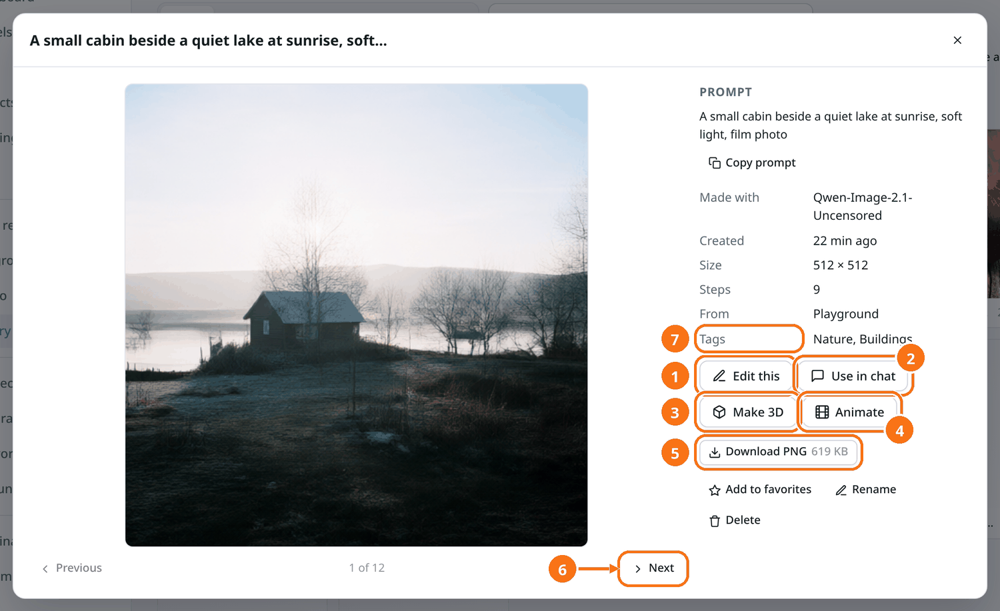

1. **Edit this.** Opens the image editor with this picture.
2. **Use in chat.** Attaches it to a new chat message (for vision models).
3. **Make 3D.** Sends it to the 3D studio.
4. **Animate.** Sends it to the video studio.
5. **Download.**
6. **Previous / Next.** The arrow keys work too.
7. **Tags** a decision model gave the picture.

The prompt, model, size and settings are kept with each item. You can also favourite, rename or delete it.

### Connectors

Connect accounts so your Tiiny can read and act on them in TiinyOS's Task Mode: **Gmail**, **Outlook Mail**,
other email (**IMAP/SMTP**), **Google Calendar**, **Outlook Calendar**, **Telegram**, **Discord**, **WhatsApp** and **X**.
You can also add your own tools as **MCP servers**. Here you connect, check and disconnect them.

### Integrations

Your Tiiny speaks the same language as OpenAI, Anthropic (Claude) and Ollama, so many apps can use it. Apps on your
computer, AI assistants and your own code connect through the panel's **gateway** at `http://127.0.0.1:8766`, each
with its own key. Cloud services can't reach your Tiiny.

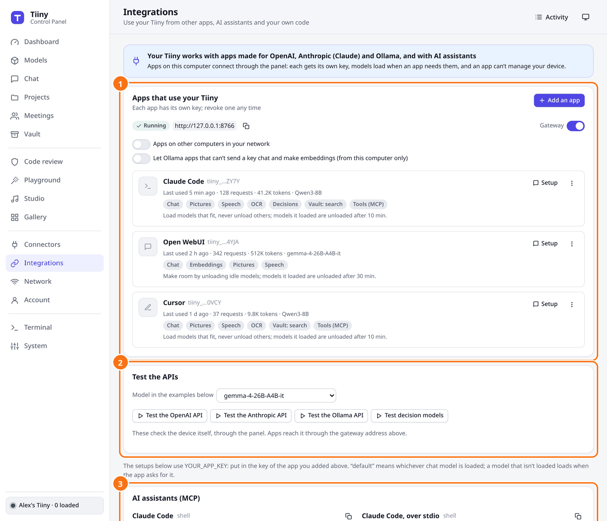

1. **Apps that use your Tiiny.** The gateway's address and whether it's running.
   - **Add an app:** pick the app (Claude Code, Cursor, Open WebUI, …), what it may use and how it loads models. You get
     its key, shown only this once, with the app's setup filled in.
   - **Each app** shows when it was last used, how much, and what it may use. **Setup** shows its setup again (with a
     placeholder for the key). Its **⋮** menu edits it, makes a new key, or revokes it.
   - **Apps on other computers in your network:** off unless you switch it on. Without `--tls-cert` and `--tls-key`, keys
     travel unencrypted through your network.
   - **Ollama apps without a key:** for Ollama apps that can't send one. Only chat and embeddings, only from this computer.
2. **Test the APIs:** checks the device's OpenAI, Anthropic and Ollama APIs and decision models with one click each.
3. **Ready-to-copy setups**, filled in with the gateway's address:
   - **AI assistants (MCP):** Claude Code, Claude Desktop, Cursor.
   - **Agents:** OpenClaw, Hermes Agent.
   - **Code:** OpenAI SDK (Python, JavaScript), curl, Anthropic SDK, Ollama, LangChain, LlamaIndex.
   - **Chat apps:** Open WebUI, Obsidian Copilot, apps made for Ollama.
   - **Editors:** Continue, Zed, aider, `llm`.
   - **Decision models (System One):** curl and Python for `/v1/systemone`.

At the bottom, **Talk to the device directly (advanced)** shows the device's own address and key, for apps on other
computers. That key can also manage the device, so use an app key when you can.

**What an app may use:** chat (OpenAI chat, completions and responses, Anthropic messages, Ollama chat and generate),
embeddings and reranking, pictures, speech (recognition and text to speech), OCR, decisions, your Vault (searching,
and separately saving), and tools for AI assistants (MCP). An app can never load, unload or delete models directly,
restart the device, or change its Wi-Fi, your account or connectors.

**When an app asks for a model that isn't loaded**, its loading policy decides:
- **Only models that are loaded:** it gets an error instead.
- **Load models that fit, never unload others** (the default).
- **Make room by unloading idle models:** the ones loaded just for a moment go first, then the least recently used.
  Pinned and busy models never do.

A model an app had to load is unloaded again 10 minutes after the app's last request (**Edit** changes that: straight
away, 2, 30 or 60 minutes, or keep it loaded). Meanwhile its card on the Dashboard says it was loaded just for that app,
with **Keep loaded**. While an app works, **Right now** on the Dashboard shows its name.

**AI assistants (MCP).** With **Tools (MCP)** ticked, an assistant can:
- ask a model on your Tiiny, so private text stays on your own hardware;
- make and edit pictures, which are also saved in the Gallery;
- transcribe recordings, read text aloud, and read the text in pictures;
- search your Vault, and save to it if you allowed that;
- ask decision models, and see what's loaded and what the device is doing.

Assistants that start a program use `python3 tiiny_ui.py mcp`, with the key in `TIINY_KEY`. That program can also hand
the assistant's files over by path. Others connect to `http://127.0.0.1:8766/mcp`. Either way, the panel must be
running.

### Network

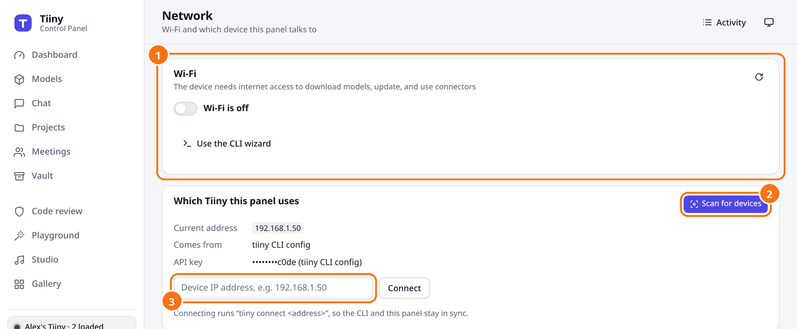

1. **Wi-Fi** for the device. It needs internet access to download models, update and use connectors. Ethernet works too.
2. **Scan for devices** finds Tiiny devices on your network and over USB-C.
3. **Connect** by address. This runs `tiiny connect`, so the command-line tool and the panel stay in step.

### Account

- **Log in**, **Log out** or **Activate a new device**.
- Change your username, password or recovery email.
- Your **API key**, and a code example.
- The **personalization profile**: what the device knows about you (occupation, preferences). It's used by TiinyOS's Task Mode, and in chats when *Use my profile* is on. You can edit it.

### Terminal

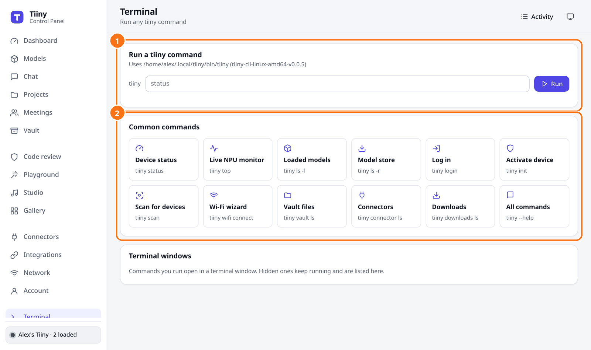

1. **Run any `tiiny` command** in a real terminal inside the page. Interactive ones work too, like `tiiny login`.
2. **Common commands**, one click each. Terminal windows can be hidden and keep running; they're listed under the **Terminals** button at the top.

### System

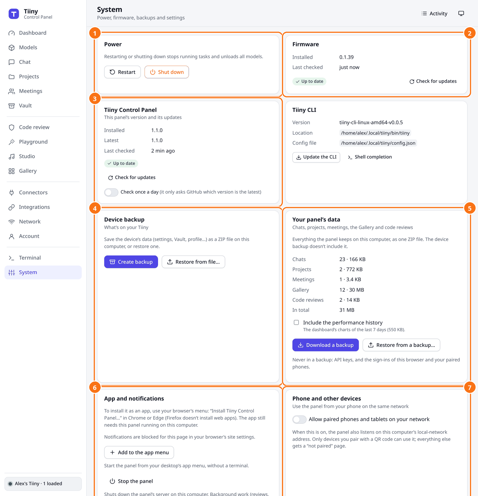

1. **Power.** Restart or shut down the device. When shutting down, keep the power connected until the light goes off.
2. **Firmware.** Your TiinyOS version, and what's new when there's an update.
   - **Install** asks first. Your Tiiny then downloads and checks the update (step 1), and installs it (step 2).
     The card shows each step's progress, through the restart at the end. You can leave the page. Keep the panel
     running until the download has finished; the panel starts the installation when it's done.
   - **Stop the update** works while it's still downloading.
   - Once the update is installed, your Tiiny waits for one restart to activate it. An update started here restarts
     it for you; otherwise (for example after restarting the panel) the card offers **Restart now**.
   - If your Tiiny asks you to log in after restarting, log in under **Account**; the update then finishes.
   - On devices without the new upgrade service, the button runs `tiiny upgrade` in a terminal instead.
3. **Tiiny Control Panel.** This panel's version and its updates.
   - **Check for updates** asks GitHub which version is the latest; nothing else is sent. Switch on **Check once a day**
     to have it ask by itself; the **System** entry in the menu then shows a dot when a new version is out.
   - **Update** shows what's new and asks first. A copy you cloned with git updates with `git pull`. Otherwise the panel
     downloads the new version from GitHub, checks it, and swaps its files, keeping the old version in the `.previous`
     folder inside the panel's folder. Your chats, projects, Gallery and settings aren't touched.
   - **Restart now** starts the new version, and the page reloads by itself. If a code review or another background job
     is running, it tells you first.
   - If the panel's own files were changed on this computer, it doesn't overwrite them. Then update with git yourself.
4. **Device backup.** Save the device's data (settings, Vault, profile…) as a ZIP file on this computer, or restore one.
5. **Your panel's data.** What the panel keeps on this computer: chats, projects, meetings, the Gallery and code reviews.
   - **Download a backup** puts all of it in one ZIP file. Tick *Include the performance history* for the dashboard's
     charts too. API keys and the sign-ins of your browser and phones are never in it.
   - **Restore from a backup…** shows what's in the file, then gives you two choices:
     - **Add what's missing:** when both have the same item, the newer one wins.
     - **Replace everything.**

     Whatever a restore replaces is set aside first, in a `.before-restore-…` folder in `~/.local/share/tiiny-ui/`.
     Tick *Also restore the panel's settings* when you move to a new computer.
6. **App and notifications.** Install the panel as an app, get a notification when long tasks finish, add it to your desktop's app menu, or stop the panel.
7. **Phone and other devices.** See [the next section](#use-it-from-your-phone).

Also here:

- The **Tiiny CLI** version, with an update button.
- **Agents** installed on the device.
- **Decision models**: which [decision model](#decision-models) the panel uses, and a pill for each place it's used.
- **Agent tools**: a pill for every tool the agent may use (see [Agent mode](#agent-mode)), which search engine it
  uses, and whether it may work on this computer.
- **Panel settings**: device address, port and API key. Leave them empty to use the command-line tool's. The `tiiny`
  program and its config file can only be chosen when you start the panel (`--tiiny` and `--cli-config`), so the page
  can't be used to make the panel run something else.

---

## Decision models

Some models in Tiiny's store don't write text: **decision models** such as **KnowLine** and **d3** read a text, a chat
or a picture and answer yes/no, pick-one and score questions with a **probability for every answer**, in well under a
second. With one on your Tiiny (KnowLine-4B, for example), the panel uses it for small decisions:

| Where | What it decides |
|---|---|
| [Agent mode](#agent-mode) | which kinds of tools a message could need, and a risk note on commands |
| [Chat](#chat) | **Auto** thinking: whether to think, and how much |
| [Chat](#chat), *Use my Vault* | which found passages fit the question |
| [Code review](#code-review) | how likely each finding is a real problem |
| [Gallery](#gallery) | tags for pictures |
| [Projects](#projects) | whether a turn holds anything worth remembering |
| [Meetings](#meetings) | action items, decisions and open questions |

- **Loading:** a feature loads the decision model when it needs it, but only if it fits next to the loaded models. It
  never unloads anything to make room, and stays loaded until you unload it.
- **Without one:** everything works as before. A feature that can't get an answer just does what it did without one.
- **Activity** lists every decision and its answers, or why one was skipped.
- **Integrations** has ready-to-copy examples for your own code (`POST /v1/systemone`, TiinyOS 0.1.39 or later).

**Choosing the model and switching uses off:** **System → Decision models**.

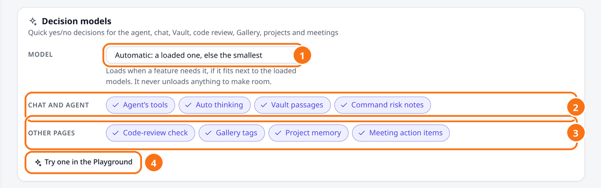

1. **Model.** *Automatic* uses a decision model that's loaded, or else the smallest one on your Tiiny. You can pick one.
2. **Chat and agent:** the agent's tools, Auto thinking, Vault passages and command risk notes.
3. **Other pages:** the code-review check, Gallery tags, project memory and meeting action items. Click a pill to
   switch that use off (**+**) or on again (**✓**).
4. **Try one in the Playground.**

**Trying one:** **Playground → Decide**, or **Try it** on the model's card.

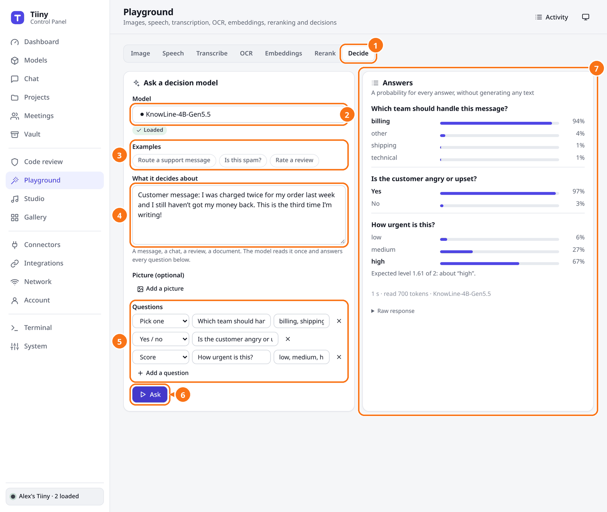

1. The **Decide** tab.
2. **Model.** It loads when you press Ask.
3. **Examples** to start from: route a support message, spot spam, rate a review.
4. **What it decides about**: a message, a chat, a review, a document. You can add a picture as well.
5. **Questions**: *Yes / no*, *Pick one* (with its options) or *Score* (levels, lowest first). Up to 64 at a time; the
   model reads the text once for all of them.
6. **Ask.**
7. **Answers**: a probability for every answer, with the likeliest in bold. A score also shows its expected level.
   *Raw response* shows what the device sent back.

---

## Use it from your phone

The panel can also listen on your computer's local-network address, but only for phones and tablets you **pair** with a QR code.

1. On your computer: **System → Phone and other devices**, switch it on, and press **Pair a phone**.
2. Scan the QR code with the phone's camera (same Wi-Fi as the computer). The pairing link works once, for 5 minutes.
3. That's it. The phone stays paired. **Remove** it from the same card at any time.

**What a phone can't do.** For safety, phones get everything except what reaches into your computer itself:
- no terminals and no panel settings;
- no browsing your computer's folders, and no code reviews or project links of folders on the computer (a phone can
  review a ZIP file it uploads);
- no revealing the API key;
- no updating the panel, and no backing up or restoring its data.

Do those on the computer.

> [!WARNING]
> Without `--tls-cert`, phones connect over plain HTTP. Use it only on a network you trust, like your home Wi-Fi.
> On shared or public Wi-Fi, someone watching the traffic could take over a paired phone's connection.

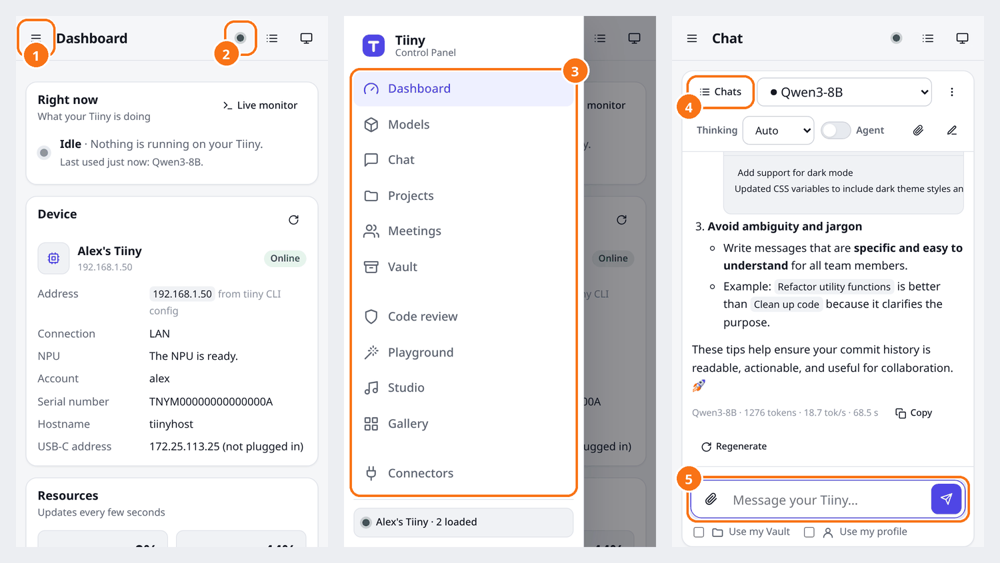

1. **☰** opens the menu with every page.
2. **The status dot.** It shows a word like *Locked* or *Offline* when something needs you.
3. **The menu**, with the device status at the bottom.
4. **Chats** slides in your list of chats.
5. **The message box.** On a phone, Return starts a new line; tap the send button to send.

- **The phone can't connect?** Your computer's firewall may block the port:
  - **Fedora, openSUSE** (firewalld): `sudo firewall-cmd --add-port=8765/tcp`. Add `--permanent` to keep the rule after a restart.
  - **Ubuntu, Debian, Mint** (ufw, if it's switched on): `sudo ufw allow 8765/tcp`.
  - **Arch**: there's no firewall unless you set one up. Manjaro may use ufw (see above).
- **Recording meetings from a phone** needs HTTPS, because browsers only allow the microphone on secure pages. Start the panel with `--tls-cert` and `--tls-key` pointing at your own certificate. On the computer itself, `127.0.0.1` already counts as secure.

---

## Install it as an app, or start it automatically

- **As an app:** in Chrome or Edge, use the browser's menu: *Install Tiiny Control Panel…*. It then opens in its own window with its own icon. Firefox doesn't install web apps. The app still needs the panel running on your computer.
- **In your app menu:** **System → Add to the app menu** creates a menu entry that starts the panel (or opens the running
  one), signed in. It keeps the `--tiiny`, `--cli-config`, `--port` and certificate options you started the panel with.
- **When you log in** (Debian, Ubuntu, Fedora, Arch and most others use systemd): create `~/.config/systemd/user/tiiny-ui.service` with:

  ```ini
  [Unit]
  Description=Tiiny Control Panel

  [Service]
  ExecStart=/usr/bin/python3 /home/alex/tiiny-control-panel/tiiny_ui.py --no-browser
  Restart=on-failure

  [Install]
  WantedBy=default.target
  ```

  Change the path to where your panel is, then run:

  ```bash
  systemctl --user daemon-reload && systemctl --user enable --now tiiny-ui
  ```

  A panel started this way doesn't open a browser. Open it once from your app menu (or run `python3 tiiny_ui.py`) to
  sign your browser in; after that a bookmark works too.

---

## Your data and privacy

| Where | What |
|---|---|
| `~/.local/share/tiiny-ui/` | Your chats, projects (with their search indexes), code reviews, meetings, the Gallery's files, and 7 days of performance history. After a restore, also `.before-restore-…` folders with what the restore replaced. |
| `.previous/` in the panel's folder | The version from before the last update (only after updating from System → Tiiny Control Panel without git). |
| `~/.config/tiiny-ui/settings.json` | Panel settings, including measured model sizes. Readable only by you. |
| `~/.config/tiiny-ui/devices.json` | Paired phones. Only fingerprints of their logins are stored, so the file can't be used to log in. |
| `~/.config/tiiny-ui/apps.json` | The apps that may use the gateway, with what they may use. Only fingerprints of their keys are stored. |
| `~/.config/tiiny-ui/browser-key` | The secret the panel signs your browser in with. Readable only by you. Delete it and restart the panel to sign every browser out. |
| `~/.local/tiiny/config.json` | The command-line tool's device address and API key. The panel only reads it. |

- **Everything stays local.** Data only goes:
  - to your Tiiny;
  - to a web page when you ask the panel to read one;
  - to the search engine when the agent searches the web (only the search words, and it asks first);
  - to GitHub when you check for a new version of the panel (only that question).
- **Only your browser.** The panel listens on `127.0.0.1` and only works in a browser it has [signed in](#5-start-the-panel), so other programs and user accounts on this computer can't use it.
- **Protected from other websites.** Websites open in your browser can't read the panel or send it commands.
- **It only runs what you started it to run.** The `tiiny` tool it uses, and whether the agent may run commands
  (`--allow-commands`, which then asks before each one), can only be set when starting it, never from the page.
- **The API key stays hidden.** It stays inside the panel's server; the page only shows it when you press **Reveal**.
- **Phones need pairing.** The phone listener is off until you turn it on, unpaired devices get nothing, and paired phones can't reach your computer's files, settings or terminals.

---

## Good to know about the device

- **After every restart or power cut, the Tiiny locks its data** until you log in. Until then, its models, Vault and connectors don't run. The panel shows *Your Tiiny is locked* with a **Log in** button.
- **NPU memory is shared.** Your device has about 48 GB. A big chat model takes about half of it, and image models take about half too. The panel measures what each model really uses and warns you before things don't fit.
- **Long, heavy jobs** (a big model reviewing lots of code, long renders) keep the NPU at full power for a long time. Use the power adapter that came with the device, keep its vents clear, and avoid starting large downloads at the same time. The device doesn't report its temperature, so the panel can't warn you about heat.

---

## Troubleshooting

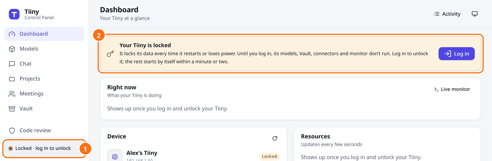

**"Your Tiiny is locked", or "502 Bad Gateway" everywhere.** Your Tiiny restarted or lost power and keeps its data
locked until you log in (1, 2). Press **Log in** (or run `tiiny login`). Everything else starts by itself a minute or two later.

**"Can't reach your Tiiny at …".**
1. Check that it's switched on and on the same network, or plugged in with USB-C.
2. Press **Network → Scan for devices**. Its address may have changed.

**"Log in to your device".** The saved key was refused. Use **Account → Log in**.

**The agent says DuckDuckGo didn't answer the search.** DuckDuckGo sometimes pauses automated searches for a few
minutes. Try again later, or choose Brave Search or your own SearXNG under **System → Agent tools**.

**The agent says "Commands are switched off".** Start the panel with `python3 tiiny_ui.py --allow-commands` (see
[Agent mode](#agent-mode)).

**🎤 says the microphone needs a secure connection.** Browsers only allow the microphone on secure pages. On this
computer, use the panel at `http://127.0.0.1:8765`. On a phone, start the panel with `--tls-cert` and `--tls-key` (see
[phones](#use-it-from-your-phone)).

**🎤 or 🔊 says there's no model for it.** Speaking needs a speech recognition model (for example Whisper), and reading
aloud needs a text-to-speech model (for example Qwen3-TTS VoiceDesign). **Find one** opens the model store at them.
Models made for copying a voice aren't used for reading aloud: they need a recording every time.

**An app says its key isn't valid.** Check that it sends the key as `Authorization: Bearer …` (or `x-api-key`), and that
the app wasn't revoked. Lost the key? **Integrations** → the app's **⋮** → **New key**.

**An app says a model doesn't fit.** The model needs more NPU memory than is free. Unload something on the Models page,
pick a smaller model, or let the app make room: **Integrations** → the app's **⋮** → **Edit** → **Loading models**.

**The gateway says port 8766 is in use.** Another program has it. Start the panel with `--gateway-port 8770` (any free
port), and use that address in your apps.

**An Ollama app can't connect.** Many Ollama apps don't send a key. Put the app's key in its settings if it has a field
for one, or switch on **Ollama apps without a key** under Integrations.

**Open WebUI in Docker can't reach the gateway.** The gateway only answers on this computer. Start the container with
`--network=host`, as in the setup, or switch on **Apps on other computers in your network** and use this computer's
address.

**An update says some of the panel's files were changed.** A file in the panel's folder was edited on this computer,
so the panel won't overwrite it. In the panel's folder, run `git stash` and then `git pull`, or download the new
version from GitHub.

**Something is wrong after an update.** The previous version is kept in the `.previous` folder inside the panel's
folder. To go back:
1. Stop the panel.
2. Move the files from `.previous` back into the panel's folder.
3. Start the panel again.

**"This browser isn't signed in".** Start the panel from your app menu, or run `python3 tiiny_ui.py` again: either
one opens it signed in, and the waiting page updates by itself. This happens in a new browser or profile, after
clearing your browsing data, or when you use a different address than the one the panel opens (`localhost` and
`127.0.0.1` sign in separately). If it says the browser can't stay signed in, allow site data for `127.0.0.1`.

**Tiiny's own desktop widget shows NPU numbers that jump around, or 8.7 GB of NPU memory.** The widget's status feed
(`/api/v1/sys/status`) lists an "NPU-0" that isn't the card your models run on. Its numbers don't match the card's own
readings, and its total memory changes between readings. On TiinyOS 0.1.39 the feed can also stand still. The panel's
dashboard and history read the card itself.

**A decision-model feature doesn't seem to do anything.** It's skipped when no decision model can answer: none on
your Tiiny, it's switched off under **System → Decision models**, or it doesn't fit next to the loaded models (the
panel never unloads anything to make room for it). **Activity** shows why.

**A model won't load.** The NPU's memory is probably full. The panel offers to unload others. Check the shares on **Models → NPU memory**.

**An image fails with "Request failed".** The image model ran out of NPU memory next to a big chat model. Unload the chat model,
or use a smaller size. In agent chats, the panel swaps the models for you.

**Projects or pinned files say "indexing".** They need an embedding model (for example `Qwen3-Embedding-0.6B`). The panel loads one when needed.

**Image edits stop after a couple of minutes.** The device gives an edit about 2½ minutes. Use about 20 steps or a smaller size.

**3D: the background ends up in the model.** TiinyOS has a background step of its own for 3D, but up to 0.1.39 the
model it needs (BiRefNet) isn't on the device, so that step fails (*"BriefNet ONNX model not found"*) and your picture
is used as it is. Get **FLUX.2-klein Background-Remove** from the model store, and Studio → 3D cuts the object out with
it instead (see [Studio](#studio)).

**A code review says "Your Tiiny stopped answering".** The review paused because the device went away. Once it's back
(and unlocked), open the review and press **Resume**.

**The phone can't connect.** See [Use it from your phone](#use-it-from-your-phone): same Wi-Fi, firewall port, pairing link not expired.

**`tiiny upgrade` fails with "check for updates: HTTP Status Error 404".** TiinyOS 0.1.38 has a new upgrade service,
and the command-line tool (v0.0.5) still asks the old one. Use **System → Firmware** in the panel, which talks to the
new service directly.

**Something else.** Open **Activity** (top right). It lists every request and command with the device's exact answer.
You can also start the panel with `--verbose`.

---

## How it works

- **Talking to the device.** The panel is a small Python web server on your computer. It talks to your Tiiny's HTTP API, the same one the `tiiny` command-line tool uses, documented at [dev.tiiny.ai](https://dev.tiiny.ai/). Interactive things (logging in, activation, Wi-Fi, benchmarks, firmware, restore) run the real `tiiny` tool in a terminal inside the page.
- **Address and key.** These come from the command-line tool's config. You can override them under **System → Panel settings**.
- **Long work** (indexing, code reviews, studio renders, meeting notes) runs in the background on the panel's server, with progress and cancel. You can close the tab.
- **Who is using the device.** The Tiiny lists the work running on its models, but every program that doesn't name
  itself, this panel included, shows there as "API". So the panel keeps a note of its own requests while they run (which
  chat, page or job they're for) and matches them to the device's list. That's how **Right now** on the dashboard can
  name them. The notes are kept in memory only.
- **Making room in NPU memory.** One planner decides whether a model fits, from the NPU card's own numbers, and what
  could be unloaded to make room. The page, background jobs, apps and tools all ask it, and models load one at a time,
  so several apps asking at once don't trip over each other.
- **Other apps** connect to the gateway (`127.0.0.1:8766`), which checks their key, loads the model if needed, and passes
  the request on to your Tiiny with the device's key. Streamed answers stay streamed.
- **Projects and pinned files** get their own search index, built with the device's embedding models.
- **Built-in libraries.** Everything works without internet access on your computer. Three small libraries are included in `static/vendor/`: [xterm.js](https://xtermjs.org/) (MIT), Google's [model-viewer](https://modelviewer.dev/) (Apache-2.0) and [qrcode-generator](https://github.com/kazuhikoarase/qrcode-generator) (MIT).

**Moving or updating the panel:**
- **Moving:** keep `tiiny_ui.py`, `tiinyui/` and `static/` together and copy them anywhere.
- **Updating:** use **System → Tiiny Control Panel**, or `git pull` if you cloned it.
- **Your data:** it stays in `~/.local/share/tiiny-ui/`, so it's still there after you move or update the panel.
- **A new computer:** download a backup under **System → Your panel's data** and restore it on the new computer.

**Removing it:**
1. Delete the panel's folder.
2. If you want your data gone too, delete `~/.local/share/tiiny-ui/` and `~/.config/tiiny-ui/`.
3. If you added the app-menu entry, remove it first under **System**.
